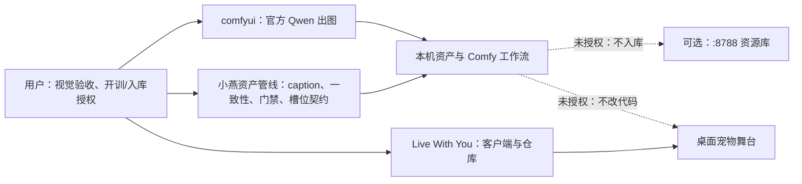
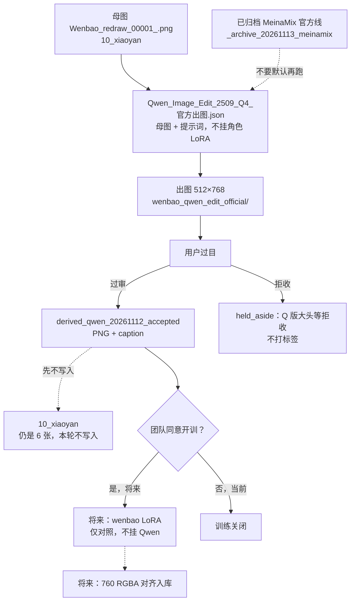
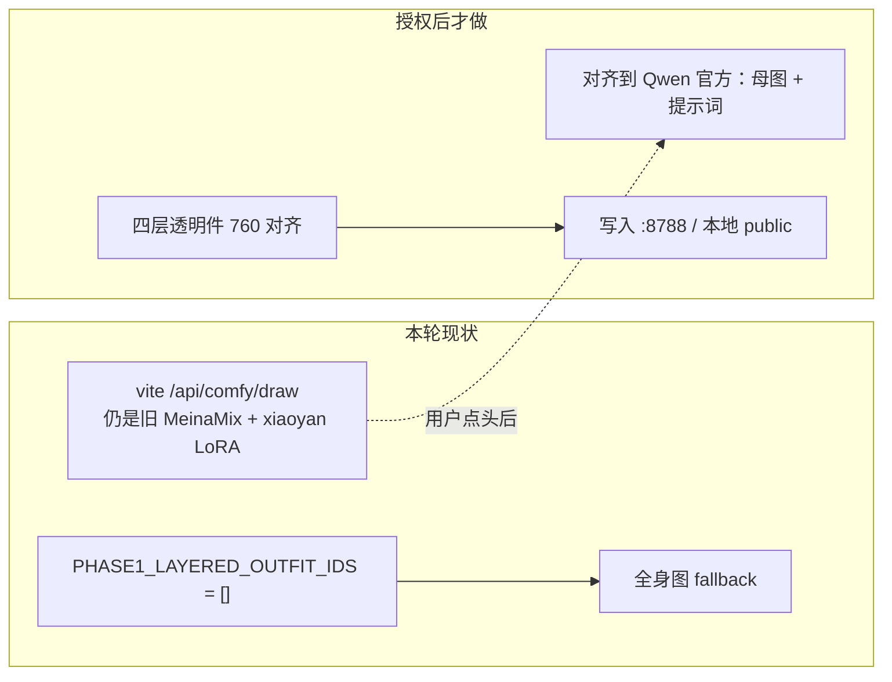
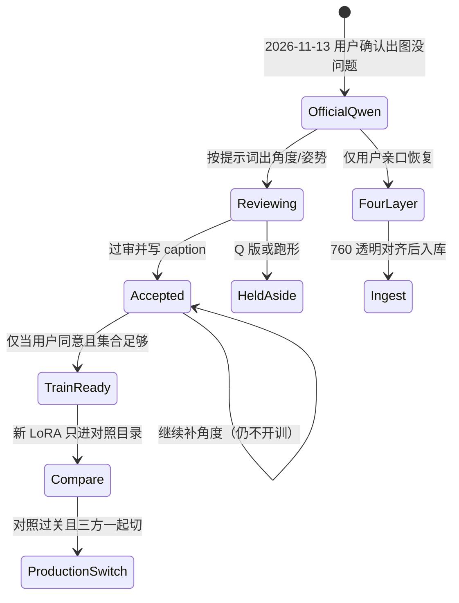

# 雯宝资产管线 · 架构

- 日期：2026-11-13（Asia/Shanghai）
- 作者：小燕资产管线
- 配套：`PRD-雯宝资产管线.md`、`设计说明-雯宝资产管线.md`

## 1. 系统上下文

三条职责边界：出图执行在 Comfy；资产规则和 caption 在管线；画面怎么显示在客户端。本轮正式像素只从「母图 → Qwen 官方 JSON → 用户过目」这条链产生。

## 2. 正式出图数据流

关键约束：Qwen 官方线是图像编辑，不是文生图；输入必须是母图，提示词改视角或姿势。Lightning LoRA 只用于 8 步加速，与角色 LoRA 不是一类东西。

## 3. 目录与路径

| 用途 | 路径 |
|------|------|
| 本机工程 | `C:\Users\ZhuanZ1\Desktop\wenbebi`，分支 `featurle/xinzhi_feat` |
| ComfyUI | `D:\xuxinzhi\ComfyUI_windows_portable_nvidia\ComfyUI_windows_portable\ComfyUI\` |
| 官方 JSON（live） | `...\user\default\workflows\Qwen_Image_Edit_2509_Q4_官方出图.json` |
| 实验 JSON | 同目录 `Qwen_Image_Edit_2509_Q4_experimental.json` |
| MeinaMix 归档 | `...\workflows\_archive_20261113_meinamix\` |
| 母图 / 现训练集 | `D:\lora_train\xiaoyan\10_xiaoyan\` |
| 过审衍生 | `D:\lora_train\xiaoyan\derived_qwen_20261112_accepted\` |
| 拒收衍生 | `D:\lora_train\xiaoyan\derived_qwen_20261112_held_aside\` |
| 更早隔离 | `D:\lora_train\xiaoyan_held_out\`（`aside` / `nsfw` / `off_character` / `orphan_txt`） |
| 训练面板 | `D:\lora_train\xiaoyan\打开训练页面.bat`（7861） |
| Kohya | `D:\kohya_ss`（7860，辅助打标） |
| 角色规格 | `tools/character/spec.json`（760 / 748 / 380） |
| 对照输出（历史） | `tools/out/wenbao-assets/_compare\`，不上正式库 |
| 资源库 | `http://192.168.124.77:8788`，`/home/xinzhi/wenbao-assets` |

## 4. 与客户端的接口（资产侧观点）

资产侧给客户端对齐时要守的契约：

1. 实时生图若对齐，目标是官方 Qwen 线：母图 `Wenbao_redraw_00001_.png` + 提示词，不挂 `wenbao_v1` 或 `xiaoyan.safetensors`。
2. 提示词不要再堆 `chibi` 和把五官写死成 Q 版模板；身份以母图为准。
3. 分层未开：空的 `PHASE1_LAYERED_OUTFIT_IDS` 意味着舞台不应指望四层文件已经存在。
4. 将来入库帧：760×760 RGBA，脚底约 748，中心约 380；带正确透明，入库后不要再洪水抠图。
5. 远端 `VITE_ASSET_BASE_URL` 为空时回退仓库 `public/assets`；产品文档写明加载失败没有自动 onerror 回退。角色不显示由 Live With You 查，本文不改代码。本轮资产侧没有向 `:8788` 写新正式图。

## 5. 状态机

当前停在「OfficialQwen + Accepted，训练关闭，四层关闭，不入库」。

## 6. 明确暂停的子系统

| 子系统 | 状态 | 恢复条件 |
|--------|------|----------|
| MeinaMix 官方 A/B 线 | 已归档，默认拒绝再跑 | 显式 `--legacy-meinamix`，且不是正式出图 |
| 角色 LoRA 训练 | 关闭 | 用户同意 + 过审集合足够 + 三方对齐 |
| 四层生成 / 拆层 / 上传 | 暂停 | 用户亲口恢复 |
| 客户端分层 | `PHASE1_LAYERED_OUTFIT_IDS = []` | 与四层资产过视觉门后，由 Live With You 改 |
| `/api/comfy/draw` 对齐 Qwen | 已识别，未改代码 | 用户点头；Live With You 向 comfyui 要 API |
| 写入 nikki / `:8788` | 禁止 | 视觉门 + 用户授权 |
