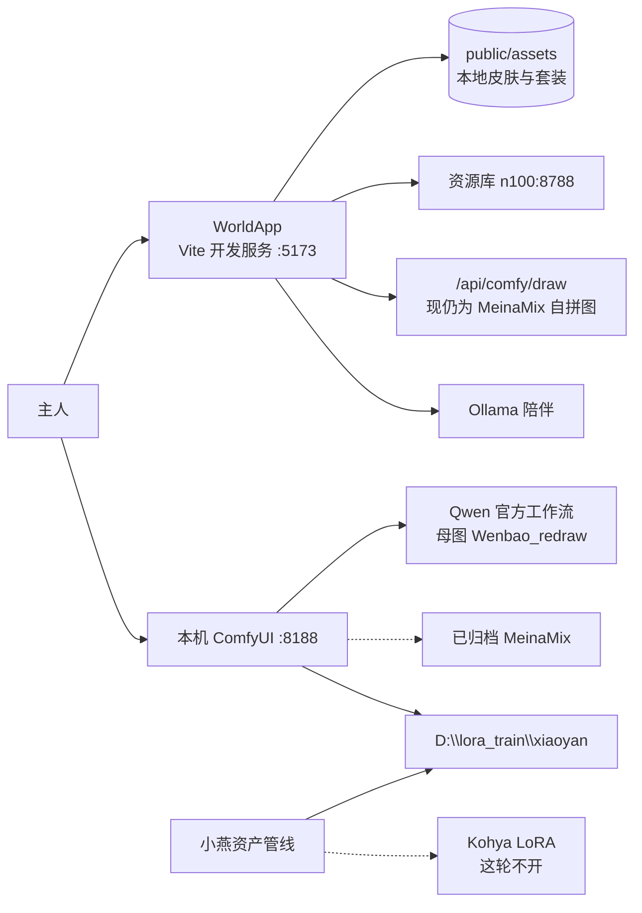
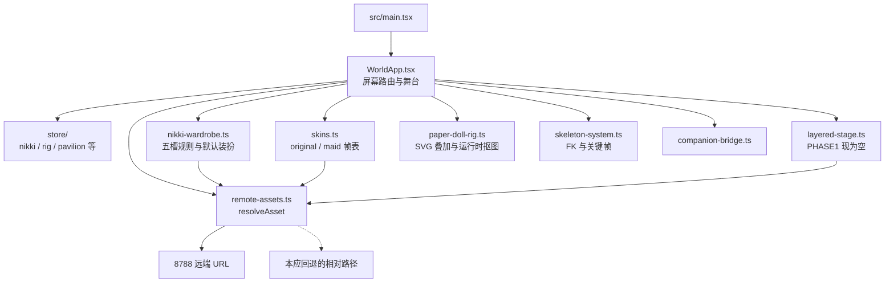
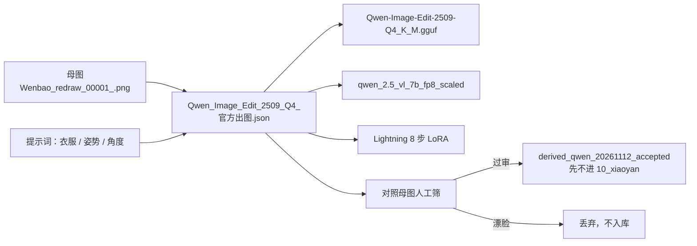
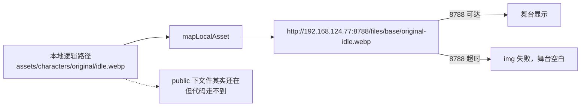

# 雯宝 架构文档

- 版本：2026-11-13（Asia/Shanghai）
- 配合：[PRD.md](./PRD.md)、[设计文档.md](./设计文档.md)、[角色不显示分析.md](./角色不显示分析.md)
- 运行时真相以本机 `featurle/xinzhi_feat` 代码为准，不以已归档的 MeinaMix 文档为准。

> 本文是客户端、舞台接线与资源回退的架构说明，由 Live With You 出具。Qwen 官方工作流内部节点与调用方式以 comfyui 文档为准；训练目录与过审集以小燕资产管线文档为准。

## 1. 技术栈

| 层 | 选型 | 说明 |
| --- | --- | --- |
| 客户端 | React 19 + TypeScript + Vite 8 | 入口 `src/main.tsx` 只挂 `WorldApp.tsx`；React DOM + CSS，无 Pixi |
| 状态 | 6 个分层 store | 例如 `useNikkiState`、`useRigState` 等；衣橱存档键 `wenbebi-nikki-wardrobe-v8` |
| 官方出图 | ComfyUI + Qwen-Image-Edit-2509 Q4 | 工作流 `Qwen_Image_Edit_2509_Q4_官方出图.json`；8GB 用 Q4 GGUF，不用官方 fp8 |
| 旧出图 | MeinaMix + 角色 LoRA | 已于 2026-11-13 归档到 `_archive_20261113_meinamix`，默认不再跑 |
| 训练 | Kohya sd-scripts（`D:\kohya_ss`） | 这轮不开训；禁止 DreamBooth（8GB OOM） |
| 资源库 | n100-server `192.168.124.77:8788` | 目录 `/home/xinzhi/wenbao-assets`；分类 dress / part / card / icon / base / ui / world |
| 陪伴 | 局域网 Ollama | `companion-bridge` → 网关 / Netlify function；失败离线回复 |
| 运行环境 | 用户 Windows 本机 ZhuanZ | 工程 `C:\Users\ZhuanZ1\Desktop\wenbebi`；Comfy 在 `D:\xuxinzhi\ComfyUI_windows_portable_nvidia\...` |

Node ≥ 22.6。验证命令：`npx tsc --noEmit`、`npm run test:mobile`、`npm run build`。

## 2. 系统上下文

## 3. 客户端模块

关键路径：

- **屏幕状态机：** `title` → `lobby` / `wardrobe` / `rig` / `stages` / `pavilion` / `codex` / `chat`。大厅、换装、骨骼、闯关共用中央舞台。
- **立绘选择：** 见设计文档三条路径。`heroSpriteSrc` 对 Comfy 衣服等待 `cutoutMap`；对默认皮肤则直接用 `activeSkin.breathe | idle`，这些 URL 已经过 `resolveAsset`。
- **分层开关：** 工作副本里 `PHASE1_LAYERED_OUTFIT_IDS = []`（相对已提交的 `["dress-snow-white"]` 尚未提交）。关闭后走路径 A/B，这不是角色消失的直接原因。
- **开发代理：** `vite.config.ts` 的 `/api/comfy/draw` 在 `npm run dev` 时生效，与官方 Qwen JSON 无关。这是客户端对齐缺口，不是资源库宕机的原因。

## 4. 官方出图架构（现行）

要点：

- 官方 fp8 大约 16GB，本机 8GB 必须走 Q4。
- `wenbao_v1.safetensors` 是 MeinaMix 时代过门的角色 LoRA，**不能**挂到 Qwen 实验/官方线上。
- `tools/run-official-dress.py` / `.mjs` 默认拒绝再跑旧七组；历史回放需 `--legacy-meinamix`。
- 客户端运行时**不读取**该 JSON；要对齐，需要按 comfyui 提供的 API 在 `/api/comfy/draw` 里提交同一套图。

## 5. 资源解析：现状与目标

### 现状（有缺陷）

`getAssetBaseUrl()`：若 `.env` 里 `VITE_ASSET_BASE_URL` 未设空，就用默认 `http://192.168.124.77:8788`。`resolveAsset` 在能映射时**只返回远端 URL**，没有加载失败回退。`docs/current-state-and-next.md` 已写明这一缺口，本次在本机复现。

### 目标（P0 修复，尚未改代码）

1. 构造阶段仍可优先远端（便于图库统一）。
2. `` 或探针在 `error` / 超时后，改用未 resolve 的本地相对路径（Vite 会从 `public/` 提供）。
3. 启动时对 8788 做短超时探活，失败则整场会话默认本地，避免每张图都挂到超时。
4. 不要为了「强制本地」删掉 `public/assets` 副本。

## 6. 数据与目录

| 数据 | 位置 | 备注 |
| --- | --- | --- |
| 客户端皮肤帧 | `public/assets/characters/original|maid/*.webp` | 本机齐全，应作为回退源 |
| 旧套装整身 | `public/assets/nikki/dress-*.png` | 有 apricot / rose / starlight；默认套装不走这些 |
| 衣橱存档 | localStorage `wenbebi-nikki-wardrobe-v8` | 可能指向用户上次的定制图 URL，需兼容失效 |
| 训练集 | `D:\lora_train\xiaoyan\10_xiaoyan` | 6 张 + caption |
| 隔离 | `D:\lora_train\xiaoyan_held_out` | 含 `aside\mother_05`，不进训练 |
| 过审衍生 | `derived_qwen_20261112_accepted` | 10 张，先不写入训练集 |
| 正式工作流 | Comfy `user/default/workflows/Qwen_Image_Edit_2509_Q4_官方出图.json` | 仓库 `tools/` 文档已标注切换 |
| 活动分支 | `featurle/xinzhi_feat` | 未提交：`layered-stage.ts`（关闭四层）、管线文档、`generate-comfy-assets.mjs` |

## 7. 约束与风险

- **资源单点：** 8788 不可达则角色消失——当前最高优先级技术风险，且已发生。
- **双出图入口不一致：** 官方已是 Qwen，开发代理仍是 MeinaMix，容易在幻阁里「看起来像出图、实际是旧脸」。
- **未提交改动混杂：** 工作区有大量 `tools/out`、bak、specs；提交时不要把对照垃圾和实验脚本带进仓库。
- **四层过早打开：** 整身图当分层会错层，保持关闭。
- **分支：** 改动打 feat 分支；PR #2 已在 main，不回退、不擅自同步。
