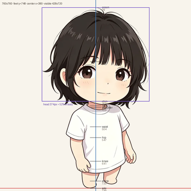
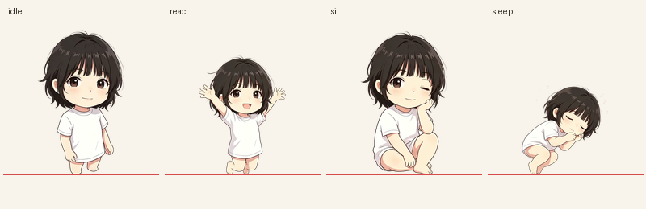
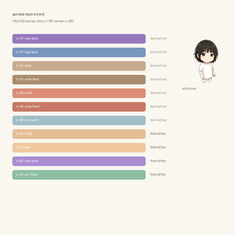
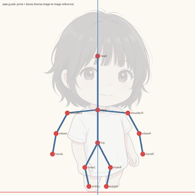

# 角色底模与部件化方案（提案）

> 状态：**设计提案，未改代码**。等你确认第 13 节的选择后再落地。
> 对照：[产品宪章 V2](./product-charter.md)、[移动版结构](./mobile-architecture.md)、[Spine 接入](./spine-integration.md)
> 日期：2026-10-29

---

## 0. 先给结论

1. **底模值得做，但它是「规范」，不是「动作生成器」。**
   它能统一：画布尺寸、脚底线、中心线、头身比、关键点、配色槽、命名、校验容差。
   它不会自动产出协调的走路、坐下、浇水——那些仍然要么逐姿势画，要么上骨骼。

2. **部件拆分解决的是「外观组合」，不是「动作」。**
   换发型、换衣服、换配色可以靠拆件；坐下、躺下、抬手浇水仍然需要姿势变体或骨骼。

3. **推荐顺序：规范 → 拆件 → 组合 → 动作分批。**
   先把白色角色拆成 10–14 个部件，用脚本合成现有 13 帧做 A/B 对比；
   画质确认可接受，再扩第二套服装/发型；最后才考虑运行时纸偶或 Spine。

一句话：**底模让「出新外观」变便宜，部件让「出新组合」变便宜，但「出新动作」仍然要花美术时间。**

---

## 1. 现状核对（只读证据）

### 1.1 当前角色帧

| 皮肤 | 帧 | 数量 | 磁盘 |
| --- | --- | --- | --- |
| `original`（默认） | idle / breathe×4 / walk×4 / react / sit / sleep / avatar | 13 | 697.3 KiB |
| `maid` | idle / breathe×4 / walk×4 / react / avatar | 11 | 807.8 KiB |

- `/Users/xuxinzhi/Documents/gowork/live-with-you/public/assets/characters/`
- 单帧 760×760 RGBA ≈ 2.2 MiB 显存；13 帧 ≈ **28.7 MiB**
- 女仆源图 1024×1280、**无 alpha**（不透明），靠脚本 flood-fill 抠图
- 白色角色源图有 alpha，但也是**单层平面插画**

### 1.2 渲染假设

| 位置 | 假设 |
| --- | --- |
| `skins.ts` | 每套皮肤 = 一组整帧路径 + `visibleHeight/visibleWidth/baseline` |
| `WorldView.tsx:399-421` | 按 `PlayerPose` 取整帧；缺帧按 `sleep → sit → react → idle` 回落 |
| `runtime.ts:25` | `PlayerPose = idle \| walk \| react \| sit \| sleep` |
| `poses.ts` | 动作 → 姿态的纯映射（床=sleep、桌/椅=sit、花圃=sit、其余=react） |

**结论：运行时只认识「整帧」。** 部件化要么在构建期合成好再喂给它，要么新写一层合成器。

### 1.3 已有但没接线的能力

- `?studio`（`src/Studio.tsx`）：已有 8 个部件槽（body / head / hairBack / hairFront / leftArm / rightArm / leftLeg / rightLeg），带 `pivotX/pivotY/z/parent`，能导出 JSON。
- `src/game/renderers/puppet-pet-renderer.js`：会去 `assets/characters/wenbebi/puppet.json` 取配置，读不到就回退整帧。
- **但该 `puppet.json` 和 `public/assets/characters/wenbebi/parts/` 都不存在**，所以纸偶从未真正跑起来。
- `styles.css:2127-2143` 已有走路/挥手/呼吸的 CSS keyframes（程序化旋转）。

**结论：纸偶的壳子已经存在，缺的是「分层素材 + 对位规范」。**

### 1.4 白色角色的身体比例（实测 idle）

画布 760×760，内容 428×720，脚底 y=748，中心 x=380：

| 关键点 | 相对身高 | 画布 y | 说明 |
| --- | --- | --- | --- |
| 头顶 | 0.000 | 29 | 头发最高点 |
| 脸顶 | 0.196 | 170 | 最大肤色连通块的顶部 |
| 眼睛 | ~0.30 | ~245 | 估算 |
| 下巴 | 0.535 | 414 | 最大肤色连通块的底部 |
| 肩 | ~0.55 | ~425 | 估算，被头发遮挡 |
| 腰 | ~0.66 | ~504 | 估算 |
| 胯 | ~0.72 | ~547 | 估算 |
| 膝 | ~0.85 | ~641 | 被裙摆遮住 |
| 踝 | ~0.96 | ~720 | 估算 |
| 脚底 | 1.000 | 748 | |

头部（crown→chin）**386px = 身高的 53.6%**，即约 **1.87 头身** 的 Q 版比例。
宽度：最宽处（含头发/袖子）在 35% 处、421px；头部约 396px；肩约 240px；裙摆约 259px；脚约 165px。

> 这些数字只来自 `original/idle`；新皮肤应当**被拟合到规范**，而不是反过来改规范。

---

## 2. 你的设想：哪些成立，哪些要修正

### 成立

- **统一底模能消除「每个新皮肤比例都不一样」**：现在白发和女仆的头身比、脚底位置、可见宽度都是我逐张量出来的，再加第三套就会失控。
- **部件化能让外观组合变便宜**：4 发型 × 3 服装 × 4 表情 × 3 配饰 = 144 种外观，但只需要画 14 类部件，而不是 144 套整帧。
- **AI 生成可以加速草稿**：尤其是服装、发型、配色变体。

### 需要修正的三点

**修正 1：底模 ≠ 动作生成器。**
从一张底模「生成动作图片」，AI 实际给你的是**同一角色的多张插画**，不是同一套骨骼的不同角度。四肢位置、衣褶走向、光影方向都会漂。它能当参考，不能当流水线。

**修正 2：切图 ≠ 拆件。**
把一张已经画好的插画按区域切开，会遇到四个硬问题：

| 问题 | 后果 |
| --- | --- |
| 手臂压住身体 | 手臂切走后，身体那块**从来没画**，露出洞 |
| 头发压住肩/背 | 头发移开，露出没画的后脑和肩线 |
| 裙子压住腿 | 腿的上半段不存在，抬腿就空 |
| 光影是整张画的 | 每块都带着「原来位置」的高光和阴影，拆开后光不一致 |

所以正确做法是**先画底层身体（完整、无遮挡），再往上叠服装/头发/配饰**，而不是事后切一张图。

**修正 3：任意组合 ≠ 任意动作。**
站姿的腿可以靠旋转做走路；**坐下和躺下的腿是折起来的，旋转做不出来**。所以：

- 「外观」维度可以任意组合（发型/服装/配色/配饰）
- 「动作」维度必须按**姿势家族**（stand / sit / lie）准备不同的身体/腿/裙部件，或者上骨骼

---

## 3. 三种方案对比

| | A. 固定皮肤 + 烘焙整帧（现状） | B. 部件 + 合成（纸偶） | C. 骨骼（Spine / DragonBones） |
| --- | --- | --- | --- |
| 外观组合 | 每套皮肤一套整帧 | **任意组合**（受兼容矩阵约束） | 任意组合（换贴图/皮肤） |
| 动作扩展 | 每个动作 × 每套皮肤都要画 | 程序化动作免费；复杂姿势仍需变体 | **动作可复用**，加动画即可 |
| 美术成本 | 线性增长，最贵 | 中等 | 前期最贵，后期最便宜 |
| 运行时成本 | 最低（只贴图） | 低（合成一次 + 缓存） | 中（骨骼 + 网格变形） |
| 画质上限 | **最高**（整张精修） | 中（硬切会像纸片） | 高（可做形变） |
| 现在能不能做 | 已上线 | 壳子已有，缺素材 | 缺编辑器流程与授权 |
| 主要风险 | 组合爆炸 | 接缝、光影不一致 | 工期、绑定质量 |

**组合爆炸的账**（按 144 种外观算）：

- A 方案烘焙：144 × 13 帧 = **1872 张** × ~60 KiB ≈ **110 MB**
- B 方案部件：约 **36 张**部件图（发型 8 + 服装 9 + 表情 4 + 身体 3 + 四肢 12）≈ **2 MB**
- 差 **50 倍**

但 B 的代价是：坐/躺要单独出部件变体，且硬切会有接缝。

---

## 4. 推荐架构

```
┌──────────────────────────────────────────────┐
│ 1. Spec（底模规范，唯一真源）                  │
│    canvas / baseline / centerX / 头身比        │
│    关键点 / 调色板 / 槽位 / 容差               │
│    → 同时喂给：构建脚本、运行时、测试、AI 提示   │
└──────────────────┬───────────────────────────┘
                   │
┌──────────────────▼───────────────────────────┐
│ 2. Kit（部件库）                               │
│    <skin>/character.json                      │
│    <skin>/parts/<slot>.<poseFamily>.<variant>.webp │
│    每个部件都按 Spec 对位，自带 10–15% 重叠区    │
└──────────────────┬───────────────────────────┘
                   │
┌──────────────────▼───────────────────────────┐
│ 3. Composition（合成）                         │
│    build 期：把预设 look 合成成现有 13 帧       │
│    run 期：玩家自选 look → 合成一次 → 缓存纹理   │
│    输出仍然是「整帧」，渲染层不用改              │
└──────────────────────────────────────────────┘
```

关键设计：**合成器的输出 = 现在的整帧格式。** 这样：

- `WorldView.pickFrame()` 不用改
- `runtime.ts` 的 `PlayerPose` 不用改
- 现有 23 个测试和 390×844 验收脚本继续有效
- 纸偶/骨骼可以以后再换实现，不影响上层

---

## 5. 底模规范 v1

### 5.1 画布约定（沿用现状，不改）

| 项 | 值 |
| --- | --- |
| 画布 | 760 × 760 |
| 脚底基线 | y = 748 |
| 水平中心 | x = 380 |
| 站立可见高 | 720（允许 ±7） |
| 站立可见宽 | 428（允许 ±10） |

### 5.2 关键点（归一化，0–1，相对可见高度）

```ts
// 相对「头顶」为 0，脚底为 1
export const LANDMARKS = {
  crown:       0.000,   // 实测
  faceTop:     0.196,   // 实测（最大肤色连通块顶部）
  eye:         0.300,   // 估算
  chin:        0.535,   // 实测（最大肤色连通块底部）
  neck:        0.548,   // 估算
  shoulderL:   0.555,   // 估算，仅 y
  shoulderR:   0.555,
  waist:       0.660,   // 估算
  hip:         0.720,   // 估算
  knee:        0.850,   // 估算，被裙摆遮住
  ankle:       0.960,   // 估算
  sole:        1.000,   // 基线
} as const;
```

> 这是**白色角色**的拟合值。规范本身只规定「必须存在这些点」，具体 y 允许每套皮肤在 ±3% 内微调，但要写进 `character.json` 并被校验。
> 标「实测」的点来自脚本对 `original/idle` 的像素分析；标「估算」的点是人工读数，
> P0 落地时应当用同样的脚本重新测一遍，不要沿用这组估算值当基准。

### 5.3 调色板槽位

```ts
export const PALETTE_SLOTS = [
  "hair", "hairShade",
  "skin", "skinShade", "blush",
  "outfitMain", "outfitShade", "outfitAccent",
  "legwear", "shoe",
  "lineart",
] as const;
```

每套皮肤必须给出 11 个 hex。用途：

1. AI 生成提示词里锁色
2. 构建脚本做色差校验（ΔE ≤ 6）
3. 换配色变体时只替换色值，不重画

### 5.4 对位模板图

构建脚本从参考帧自动生成 `_spec/base-template.png`：

- 半透明剪影（alpha 12%）
- 关键点十字线
- 基线、中心线、头框

用途：AI 出图后叠加比对、人工修图时对齐。**它不是要上线的素材。**

本次已用脚本生成四张实测图（见 [`spark-output/audit/character-rig/`](../spark-output/audit/character-rig/)）：

| 文件 | 内容 |
| --- | --- |
| `base-template-390.png` | 760×760 缩到 390，带 10 个关键点、基线、中心线、头框 |
| `pose-families.png` | idle / react / sit / sleep 四姿势按同一基线并排 |
| `part-slots-390.png` | 11 个部件槽的 z 序（谁在身后、谁在身前） |
| `pose-guide-390.png` | 关节 + 骨骼引导图，可直接当 image-to-image 参考 |

> 这四张图由一次性脚本生成，脚本尚未入库；P0 会把它固化为 `tools/character/make-base-template.py`，
> 之后换皮肤也能一键重出。`pose-guide` 里的关节坐标是按剪影**估算**的（假设），
> 不是从原画里检测出来的骨骼点。





实测关键值：可见 428×720、脚底 748、中心 380；头（crown→chin）**386px = 身高的 53.6%**，
即约 **1.87 头身**；最宽处在 35% 高度、421px（含头发与袖子），裙摆约 259px，脚约 165px。

### 5.5 命名与目录

```
public/assets/characters/
  _spec/
    spec.json              ← 机器可读的规范
    base-template.png      ← 对位模板（不上线）
  original/
    character.json         ← 这套皮肤的部件清单
    parts/
      body.stand.base.webp
      head.stand.base.webp
      face.stand.neutral.webp
      hair-front.stand.short.webp
      hair-back.stand.short.webp
      arm-l.stand.base.webp
      ...
  maid/
    ...
```

---

### 5.6 容差必须按姿势家族分组（实测，不是假设）

拿「站立高 720 ± 7、脚底 748 ± 1、中心 380 ± 2」这一条**单一容差**去校验现有 22 个姿势帧（不含两张头像），
会误杀 9 帧：

| 帧 | 可见高 | 相对站立 | 脚底 | 误杀原因 |
| --- | ---: | ---: | ---: | --- |
| original `breathe-2` | 723 | +3 | 745 | 呼吸**故意抬升** 3px，脚底离开基线 |
| original `breathe-3` | 726 | +6 | 744 | 抬升 4px，超过 ±1 |
| original `breathe-4` | 723 | +3 | 746 | 抬升 2px |
| original `react` | 593 | **−127** | 748 | 跳跃姿势本来就更矮 |
| maid `breathe-2` | 717 | −3 | 745 | 同呼吸抬升 |
| maid `breathe-3` | 720 | +0 | 744 | 抬升 4px |
| maid `breathe-4` | 717 | −3 | 746 | 抬升 2px |
| maid `react` | 704 | −16 | 748 | 女仆站立高本身是 714，不是 720 |
| maid `walk-1` | 710 | −10 | 748 | 走路压缩，属正常 |

**结论：规范不能只有一组数字。** 必须按「皮肤 × 姿势家族」给容差，
且每个皮肤的基准取它自己的 `idle`，不是白色角色的 720。

修正后的 v1 容差表：

| 姿势 | 高度容差 | 脚底容差 | 中心容差 | 说明 |
| --- | --- | --- | --- | --- |
| `idle` | 基准 ±1 | 748 ±0 | 380 ±1 | 基准帧，最严 |
| `breathe-*` | +0 ~ +8 | 744–748 | ±1 | 允许抬升，不允许下沉 |
| `walk-*` | −12 ~ +2 | 748 ±1 | ±2 | 允许压缩与 1–2px 横向摆动 |
| `react` | 基准 −130 ~ −5 | 748 ±1 | ±2 | 跳跃/鞠躬姿势差异大 |
| `sit` | 基准 −25 ~ +2 | 748 ±1 | ±2 | 坐下略矮 |
| `sleep` | 基准 −300 ~ −250 | 748 ±1 | ±2 | 躺下约为站立 60–62% 高 |

其中「基准」= 该皮肤 `idle` 的实测可见高（白色 720、女仆 714）。
这份表已用脚本跑过当前全部 22 个姿势帧：**0 误报**。

## 6. 部件契约

### 6.1 槽位表

| slot | z | 需要底层 | 姿势变体 | 说明 |
| --- | --- | --- | --- | --- |
| `hair-back` | 10 | 否 | stand / sit / lie | 长发必须分前后 |
| `legs-back` | 15 | 是 | 三个家族 | 藏裙后；抬腿时可见 |
| `body` | 20 | — | 三个家族 | **完整无遮挡**的底层身体 |
| `arms-back` | 25 | 是 | 三个家族 | 被身体挡住的臂 |
| `outfit` | 30 | 是 | 三个家族 | 上衣/裙，可继续拆 |
| `arms-front` | 40 | 是 | 三个家族 | 前面的臂 |
| `head` | 50 | 是 | stand / sit / lie | 脸+耳+颈 |
| `face` | 55 | 否 | 三个家族 | 眼/眉/嘴/腮红 |
| `hair-front` | 60 | 否 | 三个家族 | 刘海 |
| `acc-head` | 70 | 否 | 复用 | 发饰/帽子 |
| `acc-hand` | 45 | 否 | 复用 | 手持物 |



> 这张图只表达**顺序关系**，不表达真实裁切形状。实际部件按各自包围盒裁切（见 9.2），
> 每件只比自身内容大 10–15%，不是整张 760×760。

### 6.2 三条硬规则

1. **底层必须完整。** `body` 槽在任何姿势下都不能有透明洞；被遮住的部分也要画。
2. **部件自带重叠。** 手/腿/发与身体的接缝处多画 10–15%，合成后看不到断口。
3. **光从正面上方来。** 所有部件同一光照约定，禁止单件自带投影。

### 6.3 姿势家族

| 家族 | 帧 | 腿的处理 |
| --- | --- | --- |
| `stand` | idle / breathe / walk / react | 直腿，可程序化旋转 |
| `sit` | sit（书桌/长椅/花圃） | **折腿专用部件**，不旋转 |
| `lie` | sleep（床） | **躺姿专用部件**，不旋转 |

**不允许**用旋转把 stand 的腿掰成 sit——膝盖会错位、裙摆会穿帮。

姿势引导图（同一套关节，可直接作为 img2img 参考）：



生成新姿势时，把「底模剪影 + 关节图 + 目标姿势描述」一起给模型，
比只给文字更容易保住比例与脚底位置。

### 6.4 兼容矩阵

不是所有组合都成立。用一张表显式声明：

```json
{
  "hair-front.long": { "excludes": ["acc-head.hat"] },
  "outfit.pajama":   { "families": ["stand", "sit", "lie"] },
  "outfit.dress":    { "families": ["stand", "sit"] }
}
```

UI 只展示合法组合，避免玩家拼出穿模。

---

## 7. 外观与存档

### 7.1 外观对象

```ts
export interface CharacterLook {
  skin: CharacterSkinId;      // original / maid
  hair: string;               // short / long / twin
  outfit: string;             // dress-white / pajama / apron
  face: string;               // neutral / smile / sleepy
  accessory: string | null;   // ribbon / hat / none
}
```

### 7.2 存档兼容

- 保留 `world.skin`（老字段不动，旧档照常读）
- 新增 `world.look?: CharacterLook`
- `normalizeWorldState`：
  - 缺 `look` → 用 `skin` 推导默认 look
  - 非法值 → 逐字段回默认
  - 未知 hair/outfit → 回 `default`，**不丢整条 look**
- 只存字符串 id，不存像素、不存组合结果

### 7.3 预设

`look` 的命名组合就是商店/预设：

```ts
export const PRESETS = {
  "white-day":   { hair: "long",   outfit: "dress-white", face: "neutral" },
  "white-sleep": { hair: "long",   outfit: "pajama",      face: "sleepy" },
  "maid":        { hair: "twin",   outfit: "maid",        face: "smile" },
};
```

---

## 8. 素材流水线

### 8.1 生成顺序（顺序不能反）

1. **底模**：规范 + 对位模板（不生成图，自动产出）
2. **底层身体**：站/坐/躺三套，完整无遮挡、纯色底
3. **服装**：先做一套基础，覆盖在三套身体上
4. **头发**：后发 → 前发，分两件
5. **脸**：眼/眉/嘴/腮红，单独一件，方便换表情
6. **配饰**：最后，可选

### 8.2 生成约束（写进提示词，不靠记性）

| 约束 | 值 |
| --- | --- |
| 画布 | 1024×1536，角色脚底贴底边 |
| 视角 | 正面、平视、无透视 |
| 光照 | 均匀正面光，无投影、无环境色 |
| 背景 | 纯色（白或 #00FF00），便于 flood-fill |
| 风格 | 与现有 `public/assets/idle.webp` 一致 |
| 参考图 | 每次带上现有 idle 做 image reference |
| 随机种子 | 固定，便于复现 |
| 重叠区 | 接缝处多画 10–15% |

可直接用的提示词骨架（替换 `{slot}` / `{pose}` / `{palette}`）：

```text
Character turnaround reference, single full-body figure, front view, orthographic,
no perspective, standing straight, feet at the very bottom edge, centered.
2-head-tall chibi proportions, ~1.87 heads, large head, small body.
{slot} layer only: {slot description}.
Pose family: {pose}  (stand / sit / lie).
Palette locked to: {palette}
Flat even lighting from the front, no cast shadow, no ambient occlusion,
no background objects, plain solid #00FF00 background, clean silhouette,
crisp edges, consistent line weight, same art style as the reference image.
Do not add text, watermark, border or extra limbs.
```

配套的负面提示：

```text
three-quarter view, side view, perspective, foreshortening, cropped feet,
extra fingers, extra limbs, cast shadow on ground, gradient background,
blurry, jpeg artifacts, text, watermark
```

> 关键点：**一次只生成一个部件**。让模型一次画「完整可拆角色」几乎必然失败；
> 分件生成、逐件校验、最后合成，才是可复现的流水线。

### 8.3 自动处理（复用现有脚本）

`tools/build-character-assets.py` 已有：flood-fill 抠图 → 去白边 → trim → 缩放到同一基线。

新增 `tools/character/`：

| 脚本 | 作用 |
| --- | --- |
| `verify-sheet.py` | 按 5.1/5.2/5.3 校验每张部件 |
| `compose-presets.py` | 把 `character.json` 合成成 13 帧 |
| `make-base-template.py` | 从参考帧生成对位模板 |
| `prompt.md` | 从 spec 拼出的生成提示词模板 |

### 8.4 校验指标

| 指标 | 容差 | 失败处理 |
| --- | --- | --- |
| 可见高 | 720 ± 7 px | 重新缩放 |
| 脚底 | 748 ± 0 | 重新对齐 |
| 水平中心 | 380 ± 2 | 重新对齐 |
| 头身比 | 0.50–0.54 | 退回重画 |
| 主色 ΔE | ≤ 6 | 退回或调色 |
| 与模板剪影 IoU（站姿） | ≥ 0.90 | 退回重画 |
| 底层透明洞 | 0 | 必须补画 |
| 边缘近白像素 | < 3% | 重新抠图 |

### 8.5 人工修图清单（AI 之后再跑一遍）

- 接缝处的白边、脏边
- 单件自带的投影（必须去掉）
- 头发与肩的重叠区
- 裙摆与腿的重叠区
- 表情与脸型的贴合

**预算：每个部件 15–30 分钟修图，一套 12 件约 4–6 小时。**

---

## 9. 渲染接入

### 9.1 两阶段

| 阶段 | 做法 | 何时用 |
| --- | --- | --- |
| build 期 | 预设 look 合成成整帧，写进 `assets/characters/<preset>/` | 上线默认外观 |
| run 期 | 玩家改 look → 合成一次 → `RenderTexture` 缓存 | 衣柜/自定义 |

### 9.2 内存

| 方案 | 纹理 |
| --- | --- |
| 现在（13 张整帧 760²） | ≈ 28.7 MiB |
| 部件（按 bbox 裁剪，约 14 张） | ≈ **3–4 MiB** |
| 合成缓存（16 帧 760²） | ≈ 35 MiB（只在开启自定义时） |

部件按自身包围盒裁剪，是省内存的关键；不要每件都 760×760。

### 9.3 动作

| 动作 | 实现 |
| --- | --- |
| 呼吸 | 整体缩放 + 抬升（已有 4 帧烘焙；部件化后可程序化） |
| 走路 | 手臂/腿绕 pivot 正弦旋转（`styles.css` 已有 keyframes 可移植） |
| 坐下 / 躺下 | 切换姿势家族的部件变体，零旋转 |
| 短交互 | `react` 帧或整体缩放 |
| reduced-motion | 只出静帧，不旋转、不缩放 |

### 9.4 不建议现在做的

- 运行时逐骨骼编辑器
- Spine/DragonBones 绑定（等动作超过 ~10 个再评估）
- 3D 底模渲染

---

## 10. 文件改动清单（提案）

### 新增

| 文件 | 作用 |
| --- | --- |
| `docs/character-rig-design.md` | 本文 |
| `src/mobile/world/character/spec.ts` | 画布、关键点、调色板、槽位、容差（纯数据） |
| `src/mobile/world/character/look.ts` | `CharacterLook`、预设、兼容矩阵（纯函数） |
| `src/mobile/world/character/compose.ts` | 浏览器端合成（canvas → texture），带缓存 |
| `public/assets/characters/_spec/spec.json` | 机器可读规范 |
| `public/assets/characters/_spec/base-template.png` | 对位模板（不上线） |
| `public/assets/characters/original/character.json` | 部件清单 |
| `public/assets/characters/original/parts/*.webp` | 部件 |
| `tools/character/verify-sheet.py` | 校验 |
| `tools/character/compose-presets.py` | 构建期合成 |
| `tools/character/prompt.md` | 生成提示词模板 |

### 修改

| 文件 | 改什么 |
| --- | --- |
| `src/mobile/world/skins.ts` | 增加 `parts` / `character.json` 引用；保留整帧作为回退 |
| `src/mobile/world/WorldView.tsx` | 增加 `setLook()`，合成后替换帧；整帧逻辑保留 |
| `src/mobile/engine/types.ts` | `WorldState.look?` |
| `src/mobile/world/state.ts` | `normalizeWorldState` 补 `look` 默认值 |
| `src/mobile/WorldApp.tsx` | 「更多 → 角色外观」从两选一扩成槽位选择 |
| `tests/mobile-engine.test.mjs` | 部件存在性、组合合法性、look 归一化 |

---

## 11. 分阶段落地

### P0 · 规范与校验（0.5 天，不改运行时）

- 写 `spec.ts` + `spec.json`
- 写 `verify-sheet.py`
- 生成对位模板
- 对**现有 22 个姿势帧**（24 张图，含两张头像）跑校验，输出报告

**验收**：报告能指出每帧的高/基线/中心/主色偏差；`tsc`/`build` 通过。
**回滚**：纯新增文件，删除即可。

### P1 · 白色角色拆件 + A/B（1–2 天）

- 拆 12 件：body / head / face / hair-front / hair-back / arm-l / arm-r / leg-l / leg-r / skirt / shoe / 空配饰位
- 三套姿势家族（stand / sit / lie）
- `compose-presets.py` 合成 13 帧
- 与原整帧做像素对比 + 390×844 截图

**验收**：
- 站姿合成帧与原帧剪影 IoU ≥ 0.90
- 坐/躺允许重画，但脚底/中心必须对齐
- 390×844 下肉眼无接缝、无白边

**决策点**：画质如果明显不如整帧，就停在 P1，不往下推运行时纸偶。

### P2 · 存档 look + 运行时组合（1–2 天）

- `world.look` + normalize + 测试
- `compose.ts` + 纹理缓存
- 「更多 → 角色外观」改成槽位选择（发型/服装/表情）

**验收**：
- 3 种组合切换正常、刷新保留
- 内存增量 < 6 MiB
- 换装后点角色、坐下、躺下都正常

### P3 · 第二套服装/发型（1 天）

验证「加一套外观只需要加部件，不用重画 13 帧」这个假设是否成立。

**验收**：新增 1 套服装 + 1 个发型，只增加 ≤ 6 张部件图。

### P4 · 动作补齐（按需）

- 浇水、收花、挥手等专属动作
- 若动作超过 ~10 个且组合很多，再评估 Spine

---

## 12. 风险与「不做什么」

### 风险

| 风险 | 影响 | 缓解 |
| --- | --- | --- |
| 硬切像纸片 | 观感下降 | P1 先 A/B；不行就停在整帧 |
| AI 一致性差 | 每张脸都不一样 | 固定种子 + 参考图 + 调色板校验 + 人工修 |
| 接缝白边 | 明显穿帮 | 多画 10–15% 重叠 + 去白边 + 修图 |
| 组合爆炸 | 素材失控 | 槽位预算 + 兼容矩阵 + 只做必要变体 |
| 姿势家族成本 | 坐/躺要重画 | 先只做 stand 家族，坐/躺继续用整帧 |
| 存档膨胀 | 旧档出问题 | 只存 id 字符串；逐字段回落 |

### 不做什么

- 不做 3D 底模 / 多角度渲染（成本远超收益）
- 不做运行时逐骨骼编辑器
- 不现在引入 Spine（先证明整帧不够用）
- 不做无上限组合（必须有兼容矩阵和数量预算）
- 不把 AI 生成图直接上线（必须过校验 + 人工修）

---

## 13. 需要你拍板

1. **走哪条路？**
   - A：只做「规范 + 校验」，动作继续逐张画（最稳）
   - B：规范 + 拆件 + 构建期合成预设（推荐，画质可控）
   - C：规范 + 拆件 + 运行时纸偶（组合自由，但可能像纸片）
   - D：直接上 Spine（工期最长）

2. **组合范围？**
   - 只做「整套预设」（白色/女仆/睡衣），不做玩家自选
   - 做「发型 × 服装 × 表情」三槽（推荐，收益/成本比最好）
   - 再加配饰/配色（翻倍工作量）

3. **先拆哪套？**
   - 白色 `original`（默认角色，推荐）
   - 女仆 `maid`（素材更新，但只有两张原画）
