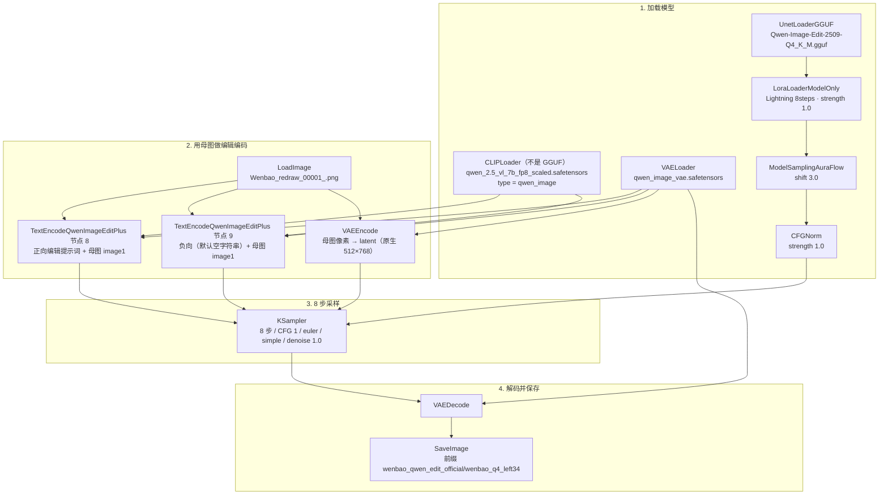

# 雯宝 · 官方出图执行说明（Qwen-Image-Edit-2509 Q4）

> 本文是 **ComfyUI 正式出图的执行 / 设计说明**，只覆盖现行官方 Qwen 线怎么跑、参数是什么、API 怎么调。  
> **不是** 产品 PRD，也 **不是** 资产管线 PRD。产品侧由 Live With You 撰写；母图、过审衍生集、训练门禁、舞台槽位由「小燕资产管线」撰写。三份文档只在接口处对齐，不互相替代。
>
> 整理日期：2026-11-13（Asia/Shanghai）  
> 维护角色：comfyui（出图执行）  
> 本文撰写前已对照磁盘上的官方 JSON、冒烟记录，以及 `tools/PIPELINE-XIAOYAN-MANAGEMENT.md` 同日补充说明。未改工作流，未提交 Git，未排队出图。

---

## 1. 范围与分工

| 角色 | 负责 | 本稿覆盖 |
|------|------|----------|
| **comfyui** | ComfyUI 官方工作流、本机执行、显存约定、`http://127.0.0.1:8188` 的调用方式 | 是 |
| **Live With You** | 仓库与客户端、产品 PRD、角色不显示排查、开发代理 `/api/comfy/draw` | 只写接口约定，**不改代码** |
| **小燕资产管线** | 母图身份、过审衍生集、caption / 训练门禁、与舞台槽位对齐 | 只引用既定锁点，不展开训练规则 |

当前共识（与管理说明一致，这轮保持不变）：

- 正式角色出图只走 Qwen 官方线，不再走 MeinaMix。
- 母图锁定 `Wenbao_redraw_00001_.png`。
- 已过审的 10 张衍生图仍留在 `derived_qwen_20261112_accepted`，不写入 `10_xiaoyan`，这轮不开训。
- 四层拆层 / 入库 / 上传到 `:8788` **继续暂停**。
- `wenbao_v1.safetensors` 是 MeinaMix / SD1.5 LoRA，**禁止**挂到 Qwen 上。
- 客户端 `/api/comfy/draw` 尚未对齐；要改仓库时由 Live With You 动手，本文只给出可照抄的 API 约定。

---

## 2. 现行官方路径

现行唯一官方角色出图工作流（UI 图，两边内容一致）：

| 位置 | 路径 |
|------|------|
| 本机 Comfy live | `D:\xuxinzhi\ComfyUI_windows_portable_nvidia\ComfyUI_windows_portable\ComfyUI\user\default\workflows\Qwen_Image_Edit_2509_Q4_官方出图.json` |
| 仓库副本 | `C:\Users\ZhuanZ1\Desktop\wenbebi\tools\workflows\Qwen_Image_Edit_2509_Q4_官方出图.json` |

2026-11-13（Asia/Shanghai）复核：

| 项 | 值 |
|----|----|
| 文件大小 | 13649 字节 |
| SHA256 | `c1c7128849923c06d36ffd19e0175a9ffff9431b3a39066f3ca29d7be8066208` |
| 两边是否一致 | 是（哈希相同，mtime 均为 2026-11-13 00:58:17 Asia/Shanghai） |
| Comfy 核心版本 | `0.28.0`（`ComfyUI/comfyui_version.py`、`pyproject.toml`） |
| 工作流内记录的前端版本 | `1.45.21`（JSON `extra.frontendVersion`） |
| API | `http://127.0.0.1:8188` |
| live 收藏 | `.index.json` 收藏了本官方文件，以及实验对照 `Qwen_Image_Edit_2509_Q4_experimental.json` |

实验文件 `Qwen_Image_Edit_2509_Q4_experimental.json` 仍留在 Comfy live 目录，作为官方线的兄弟文件，**不是**官方文件名，不要把它当正式出图入口。改官方模板时，Comfy live 与仓库 `tools/workflows/` 两边一起改。

在 Comfy 里打开的应是带「官方出图」的这份 JSON。如果界面里还开着旧的 MeinaMix 图，需要重新加载；收藏列表以 `.index.json` 为准。

---

## 3. 架构

这条线是 **母图编辑（image edit）**，不是 MeinaMix 文生图，也不是锁脸 / 锁姿七组。身份来自锁定母图，服装或角度变化写在编辑提示词里。画布尺寸由母图经 `VAEEncode` 带入，母图与冒烟输出均为 **512×768 RGB**，图中 **没有** `EmptyLatentImage`，也 **没有** `FluxKontextImageScale`。



节点号（与官方 JSON、已跑通的 API 图一致；节点 14 `MarkdownNote` 只在 UI 里，不进 API）：

| ID | 类型 | 作用 |
|----|------|------|
| 1 | `LoadImage` | 锁定母图 |
| 2 | `UnetLoaderGGUF` | Q4 编辑 UNet |
| 3 | `CLIPLoader` | Qwen Image CLIP（`type=qwen_image`，`device=default`） |
| 4 | `VAELoader` | Qwen Image VAE |
| 5 | `LoraLoaderModelOnly` | Lightning 8 步加速 LoRA，强度 1.0 |
| 6 | `ModelSamplingAuraFlow` | shift 3.0 |
| 7 | `CFGNorm` | strength 1.0 |
| 8 | `TextEncodeQwenImageEditPlus` | 正向编辑提示词 |
| 9 | `TextEncodeQwenImageEditPlus` | 负向；默认空字符串 |
| 10 | `VAEEncode` | 母图 → latent |
| 11 | `KSampler` | 8 步采样 |
| 12 | `VAEDecode` | latent → 图像 |
| 13 | `SaveImage` | 写入官方输出前缀 |

---

## 4. 参数与本机文件

这些是已跑通、不要轻易改的设定。官方 JSON 里的说明节点也写了同一套。

| 槽位 | 现行值 | 本机文件（2026-11-13 已核存在） |
|------|--------|--------------------------------|
| UNet | `Qwen-Image-Edit-2509-Q4_K_M.gguf` | `ComfyUI\models\unet\`（约 12.17 GiB） |
| CLIP | `qwen_2.5_vl_7b_fp8_scaled.safetensors`，类型 **`qwen_image`**，device `default` | `ComfyUI\models\text_encoders\` |
| CLIP 加载器 | 必须用 **`CLIPLoader`**，不要用 `CLIPLoaderGGUF` | — |
| VAE | `qwen_image_vae.safetensors` | `ComfyUI\models\vae\` |
| 加速 LoRA | `Qwen-Image-Edit-2509-Lightning-8steps-V1.0-bf16.safetensors`，`strength_model=1.0` | `ComfyUI\models\loras\` |
| AuraFlow | `shift=3.0` | — |
| CFGNorm | `strength=1.0` | — |
| 采样 | 8 步，CFG 1.0，`euler` / `simple`，`denoise=1.0` | — |
| 画布 | 原生 512×768，无 `FluxKontextImageScale` | 母图与冒烟输出均为 512×768 RGB |
| 母图 | `Wenbao_redraw_00001_.png` | `ComfyUI\input\Wenbao_redraw_00001_.png`（205412 字节） |
| 官方 JSON 默认 seed | `25091201`，UI 控件为 `fixed` | API 提交时 **不要** 把 `fixed` 当成 sampler 输入 |
| 输出前缀 | `wenbao_qwen_edit_official/wenbao_q4_left34` | 实际落盘见第 6 节 |
| 角色 LoRA | **不挂** `wenbao_v1.safetensors`，也 **不挂** `xiaoyan.safetensors` | 两文件仍在 `models\loras\`，仅保留磁盘，不进本图 |

官方 fp8 Qwen UNet 装不进 8GB 显存，继续走这条 Q4 GGUF。显卡是 NVIDIA GeForce RTX 3070 Ti Laptop GPU，nvidia-smi 总量 8192 MiB。

官方 JSON 里预填的正向提示词（左 3/4 对照；换姿势或换衣服时只改这段编辑指令，不要改成旧的 MeinaMix / chibi 堆词）：

```
Change only the camera angle to a slight left three-quarter view, about 30 to 45 degrees. The girl is still standing full body, facing slightly left of the camera. Keep the exact same girl and identity from the input image. Keep the same face, short black hair with straight bangs, large brown eyes, and a slight smile. Keep the same clothes: a white short-sleeve T-shirt with a chest pocket, white shorts, and white shoes. Keep a standing full-body view with both feet visible. Keep a plain pure white background. Keep natural anime proportions; do not make chibi, Q-version, or big-head proportions. Do not change the clothes, hairstyle, or character design.
```

负向默认为空字符串。节点 8 / 9 的 `image2`、`image3` 未接线；已跑通的 API 图里也没有提交这两个可选输入，不要无故补 `null`。

---

## 5. 已归档、禁止再当正式出图

2026-11-13（Asia/Shanghai），旧 MeinaMix 官方图已 **移动归档（未删除）**：

| 目录 | 内容 |
|------|------|
| `D:\xuxinzhi\ComfyUI_windows_portable_nvidia\ComfyUI_windows_portable\ComfyUI\user\default\workflows\_archive_20261113_meinamix\` | 换装抠图、姿势训练集 v2，以及 live 目录里当时的 `.bak*` |
| `C:\Users\ZhuanZ1\Desktop\wenbebi\tools\workflows\_archive_20261113_meinamix\` | 仓库侧同步归档 |

归档主文件：

- `MeinaMix_雯宝LoRA_换装抠图.json`
- `MeinaMix_小燕_姿势训练集_v2.json`（在 Comfy 归档目录中）

那是旧的 IPAdapter / OpenPose / FaceDetailer 七组锁脸锁姿，以及姿势训练集 v2。日常不要打开、不要排队。更早的 `_archive_20261106`、`_archive_20261108`、`_archive_20261111` 保持不动，同样不是现行官方线。

`tools/run-official-dress.py` 与 `tools/run-official-dress.mjs` **默认拒绝执行并以退出码 2 结束**，会指向现行 Qwen 官方 JSON 与上述归档目录。只有显式加上 `--legacy-meinamix` 才能回放已归档的七组路径，那是历史回放，不是正式出图。

仍在磁盘、但不是本官方线的内容：

- `wenbao_v1.safetensors`：MeinaMix / SD1.5 角色 LoRA，不能挂到 Qwen。
- `xiaoyan.safetensors` 及旧检查点：保留不删，不用于正式出图。
- `Qwen_Image_Edit_2509_Q4_experimental.json`：实验对照，保留在 live，不用这个文件名做出图入口。

`tools/PIPELINE-OFFICIAL.md` 正文仍大量描述旧七组换装路径；该文件顶部已注明以 Qwen 官方线为准，下文仅作历史说明。冲突时以 **live 官方 JSON 实际节点** 和本文为准。

---

## 6. 显存与官方冒烟记录

2026-11-13 01:11:44–01:14:16（Asia/Shanghai）用官方 JSON 做了一次 API 冒烟（只覆盖 seed，**未改**已保存的官方 JSON）。用户随后确认画面没有问题。

| 项 | 记录 |
|----|------|
| 覆盖 seed | `20261113010701`（文件内默认 seed 仍是 `25091201`） |
| 视角 / 提示词 | 官方预填的左 3/4 编辑提示词 |
| `prompt_id` | `59ee23f4-4a07-4284-a4e5-45168b3ff10d` |
| 耗时 | 提交后约 148.78 秒（约 2 分半） |
| 结果 | `status=success`，`oom=false` |
| 峰值显存 | nvidia-smi **used ≈ 7830 MiB**（01:13:51，free 188 MiB）；未 OOM |
| 输出文件 | `D:\xuxinzhi\ComfyUI_windows_portable_nvidia\ComfyUI_windows_portable\ComfyUI\output\wenbao_qwen_edit_official\wenbao_q4_left34_00001_.png` |
| 输出规格 | 300871 字节，512×768 RGB；来自节点 13，`subfolder=wenbao_qwen_edit_official`，`type=output` |
| 官方 JSON 哈希 | 提交前后均为 `c1c7128849923c06d36ffd19e0175a9ffff9431b3a39066f3ca29d7be8066208` |

已跑通的 API 图与日志在：

- `D:\lora_train\wenbao_v1\tmp_scripts\official_qwen_smoke_prompt.json`
- `D:\lora_train\wenbao_v1\tmp_scripts\official_qwen_smoke_result.json`
- `D:\lora_train\wenbao_v1\tmp_scripts\official_qwen_smoke.log`

正式输出目录是 `ComfyUI\output\wenbao_qwen_edit_official\`。这轮不把这里的图自动拷进 `public/assets`，也不走四层或 `:8788` 入库。

---

## 7. API 约定（给 `/api/comfy/draw` 对齐用）

本节只描述如何调用已经跑通的官方图。Live With You 已核对：开发时「星愿幻阁」走 `vite.config.ts` 里的 `POST /api/comfy/draw`，这条代理 **仍未对齐**。本稿核对源码后的现状如下（不在本任务改它）：

- 默认底模：`meinamix_v12Final.safetensors`（可用环境变量 `COMFY_CHECKPOINT` 覆盖）
- 默认挂 `xiaoyan.safetensors`，强度 `0.8 / 0.8`
- 正向自行拼接 `xiaoyan, chibi, ...` 五官堆词，再接用户 prompt
- 图是 `CheckpointLoaderSimple` + `CLIPTextEncode` + `EmptyLatentImage` 512×640，采样 `dpmpp_2m` / `karras`
- 提交到 `http://127.0.0.1:8188/prompt`，`client_id` 为 `wenbebi-live`
- 轮询 `/history/{prompt_id}` 的等待上限是 **120 秒**
- `SaveImage` 前缀仍是 `wenbao_lora_live`

对齐时应当 **提交本官方 Qwen 图**（锁定母图 + 编辑提示词），而不是继续拼旧文生图，也 **不要** 把 `wenbao_v1` 挂到 Qwen 上。`tools/generate-comfy-assets.mjs` 仍停在同一套旧底模，同属待对齐项，不在本文改。

### 7.1 提交方式

```
POST http://127.0.0.1:8188/prompt
Content-Type: application/json

{
  "client_id": "<调用方自定>",
  "prompt": { ...下方 API 图... }
}
```

成功时响应含 `prompt_id`，且 `node_errors` 应为空。然后：

```
GET http://127.0.0.1:8188/history/{prompt_id}
```

待 `status.status_str == success` 且 `outputs` 中出现图片后：

```
GET http://127.0.0.1:8188/view?filename={filename}&subfolder={subfolder}&type=output
```

官方冒烟默认前缀下，`filename=wenbao_q4_left34_00001_.png`，`subfolder=wenbao_qwen_edit_official`，`type=output`。Comfy 会在前缀文件名后追加 `_00001_` 这类序号。

**等待时间：** 官方冒烟从提交到成功约 **148.78 秒**。现有 `/api/comfy/draw` 的 120 秒上限按这条线会误报超时，对齐时需要加长（建议至少 180–240 秒，并继续轮询 history，不要只按固定睡眠）。

不建议用 `tools/comfy_workflow_to_api.py` 直接转这份官方 UI JSON：该转换器依赖节点上的 widget 元数据，而本官方图的加载器主要只写了 `widgets_values`，转换结果可能丢掉模型名、提示词等输入。已跑通的做法是按官方 JSON 的节点号和 `widgets_values` **按名称组装** API 图（见下方），并以 `official_qwen_smoke_prompt.json` 里的 `prompt` 为准。

### 7.2 已跑通的 API 图（节点与输入名）

下面与 2026-11-13 冒烟实际提交的 `prompt` 一致。链是 `[源节点号, 输出槽]`。可选的 `image2` / `image3` 不要写进去。KSampler 不要提交 UI 里的 `fixed`。

| 节点 | `class_type` | 输入 |
|------|----------------|------|
| `1` | `LoadImage` | `image`: `Wenbao_redraw_00001_.png`（须已在 `ComfyUI\input\`） |
| `2` | `UnetLoaderGGUF` | `unet_name`: `Qwen-Image-Edit-2509-Q4_K_M.gguf` |
| `3` | `CLIPLoader` | `clip_name`: `qwen_2.5_vl_7b_fp8_scaled.safetensors`；`type`: `qwen_image`；`device`: `default` |
| `4` | `VAELoader` | `vae_name`: `qwen_image_vae.safetensors` |
| `5` | `LoraLoaderModelOnly` | `model`: `["2", 0]`；`lora_name`: `Qwen-Image-Edit-2509-Lightning-8steps-V1.0-bf16.safetensors`；`strength_model`: `1.0` |
| `6` | `ModelSamplingAuraFlow` | `model`: `["5", 0]`；`shift`: `3.0` |
| `7` | `CFGNorm` | `model`: `["6", 0]`；`strength`: `1.0` |
| `8` | `TextEncodeQwenImageEditPlus` | `clip`: `["3", 0]`；`vae`: `["4", 0]`；`image1`: `["1", 0]`；`prompt`: 正向编辑文本 |
| `9` | `TextEncodeQwenImageEditPlus` | 同上链接；`prompt`: 负向，默认 `""` |
| `10` | `VAEEncode` | `pixels`: `["1", 0]`；`vae`: `["4", 0]` |
| `11` | `KSampler` | `model`: `["7", 0]`；`positive`: `["8", 0]`；`negative`: `["9", 0]`；`latent_image`: `["10", 0]`；`seed`；`steps`: `8`；`cfg`: `1.0`；`sampler_name`: `euler`；`scheduler`: `simple`；`denoise`: `1.0` |
| `12` | `VAEDecode` | `samples`: `["11", 0]`；`vae`: `["4", 0]` |
| `13` | `SaveImage` | `images`: `["12", 0]`；`filename_prefix`: `wenbao_qwen_edit_official/wenbao_q4_left34` |

### 7.3 允许覆盖的字段

对齐代理时，只应覆盖这些，其余保持官方图：

| 目的 | 改哪里 |
|------|--------|
| 换编辑指令（角度、姿势、衣服） | 节点 `8` 的 `inputs.prompt` |
| 需要负向时 | 节点 `9` 的 `inputs.prompt`（默认保持 `""`） |
| 换随机性 / 复现 | 节点 `11` 的 `inputs.seed`（整数）。冒烟就是这样覆盖的，没有改磁盘上的 JSON |
| 换输出文件名前缀 | 节点 `13` 的 `inputs.filename_prefix`（`子目录/文件名前缀`） |

不要覆盖、不要替换的部分：

- 母图文件名，除非产品 / 管线另行宣布新的官方母图。母图必须已经出现在 Comfy 的 `input` 目录；本官方锁是 `Wenbao_redraw_00001_.png`。
- UNet / CLIP / VAE / Lightning LoRA / AuraFlow / CFGNorm / 采样器配方。
- 不要加 `wenbao_v1`、`xiaoyan`、MeinaMix 底模、IPAdapter、OpenPose、FaceDetailer、`FluxKontextImageScale`。
- 不要把正向改回 `xiaoyan` + `chibi` + 五官堆砌，或旧的 `masterpiece, best quality, wenbao` 文生图句式。

提交前建议做与冒烟脚本相同的检查：API 图字符串里不应出现 `meinamix`、`wenbao_v1`、`xiaoyan.safetensors`，也不应出现旧锁脸锁姿节点类型。

### 7.4 最小提交示例（结构）

```json
{
  "client_id": "wenbebi-qwen-official",
  "prompt": {
    "1":  { "class_type": "LoadImage", "inputs": { "image": "Wenbao_redraw_00001_.png" } },
    "2":  { "class_type": "UnetLoaderGGUF", "inputs": { "unet_name": "Qwen-Image-Edit-2509-Q4_K_M.gguf" } },
    "3":  { "class_type": "CLIPLoader", "inputs": { "clip_name": "qwen_2.5_vl_7b_fp8_scaled.safetensors", "type": "qwen_image", "device": "default" } },
    "4":  { "class_type": "VAELoader", "inputs": { "vae_name": "qwen_image_vae.safetensors" } },
    "5":  { "class_type": "LoraLoaderModelOnly", "inputs": { "model": ["2", 0], "lora_name": "Qwen-Image-Edit-2509-Lightning-8steps-V1.0-bf16.safetensors", "strength_model": 1.0 } },
    "6":  { "class_type": "ModelSamplingAuraFlow", "inputs": { "model": ["5", 0], "shift": 3.0 } },
    "7":  { "class_type": "CFGNorm", "inputs": { "model": ["6", 0], "strength": 1.0 } },
    "8":  { "class_type": "TextEncodeQwenImageEditPlus", "inputs": { "clip": ["3", 0], "vae": ["4", 0], "image1": ["1", 0], "prompt": "<在此放入编辑提示词>" } },
    "9":  { "class_type": "TextEncodeQwenImageEditPlus", "inputs": { "clip": ["3", 0], "vae": ["4", 0], "image1": ["1", 0], "prompt": "" } },
    "10": { "class_type": "VAEEncode", "inputs": { "pixels": ["1", 0], "vae": ["4", 0] } },
    "11": { "class_type": "KSampler", "inputs": { "model": ["7", 0], "positive": ["8", 0], "negative": ["9", 0], "latent_image": ["10", 0], "seed": 20261113010701, "steps": 8, "cfg": 1.0, "sampler_name": "euler", "scheduler": "simple", "denoise": 1.0 } },
    "12": { "class_type": "VAEDecode", "inputs": { "samples": ["11", 0], "vae": ["4", 0] } },
    "13": { "class_type": "SaveImage", "inputs": { "images": ["12", 0], "filename_prefix": "wenbao_qwen_edit_official/wenbao_q4_left34" } }
  }
}
```

完整已提交图见 `official_qwen_smoke_prompt.json` 的 `prompt` 字段（其中节点 8 是官方左 3/4 提示词，seed 为冒烟覆盖值）。

---

## 8. 和其他文档、客户端资源的接口

请其它两份文档引用本节，而不是在 PRD 里复述整张参数表。

| 接口点 | 约定 |
|--------|------|
| 官方工作流文件名 | `Qwen_Image_Edit_2509_Q4_官方出图.json` |
| 身份母图 | `Wenbao_redraw_00001_.png`（Comfy `input`；仓库对照副本也在 `tools\out\wenbao-assets\_compare\user-reorg-20261111\`） |
| 客户端实时生图 | 应对齐第 7 节，而不是旧 MeinaMix 代理；等 Live With You 被明确要求后再改仓库 |
| 过审衍生集 / 开训 | 仍由资产管线把门；出图执行线不自动写入 `10_xiaoyan` |
| 四层与 `:8788` | 继续暂停。`public/assets/manifest.json` 仍写着远程根 `http://192.168.124.77:8788`，以及分层件 `body` / `dress` / `head` / `arms-front` 的映射，但本文不恢复入库 |
| 舞台用的本地资源 | 官方 Qwen 输出目前只在 Comfy `output\wenbao_qwen_edit_official\`，**没有**自动进入 `public/assets`。本稿列出了 `public/assets/characters/original\` 与 `maid\`：其中有 idle / walk / breathe 等 webp；`original\body.png`、`head.png`、`arms-front.png` 以及 `public/assets/characters\parts` 在 2026-11-13 检查时不存在。这是路径盘点，不是对「角色不显示」的结论。排查仍由 Live With You 牵头 |

管理说明 `tools/PIPELINE-XIAOYAN-MANAGEMENT.md` 上部已记录「正式出图切到 Qwen」；文中后半仍保留 2026-11-08 调整版的 MeinaMix A/B 线叙述，以及 `wenbao_v1` 过门记录。那些是历史；**现行正式出图以本文和第 2 节的官方 JSON 为准**。不要把「过门切到 wenbao_v1」理解成 Qwen 线要挂该 LoRA。

---

## 9. 明确先不做

- 不改官方工作流 JSON，不改客户端代码，不提交、不推送 Git。
- 不恢复四层生成 / 拆层 / 上传，不把出图写入 `10_xiaoyan`，不开训。
- 不删除归档文件，不删除 `wenbao_v1` / `xiaoyan` LoRA。
- 默认不运行 `run-official-dress.py` / `.mjs`；没有 `--legacy-meinamix` 时它们应继续以退出码 2 拒绝。

---

## 10. 本目录文件

| 文件 | 说明 |
|------|------|
| [execution-design.md](./execution-design.md) | 本执行 / 设计说明（Markdown） |
| [index.html](./index.html) | 可在浏览器中直接打开的 HTML 展示（无需联网） |
| [README.md](./README.md) | 目录说明 |

HTML 打开路径：`C:\Users\ZhuanZ1\Desktop\wenbebi\docs\comfy-official-qwen\index.html`。
